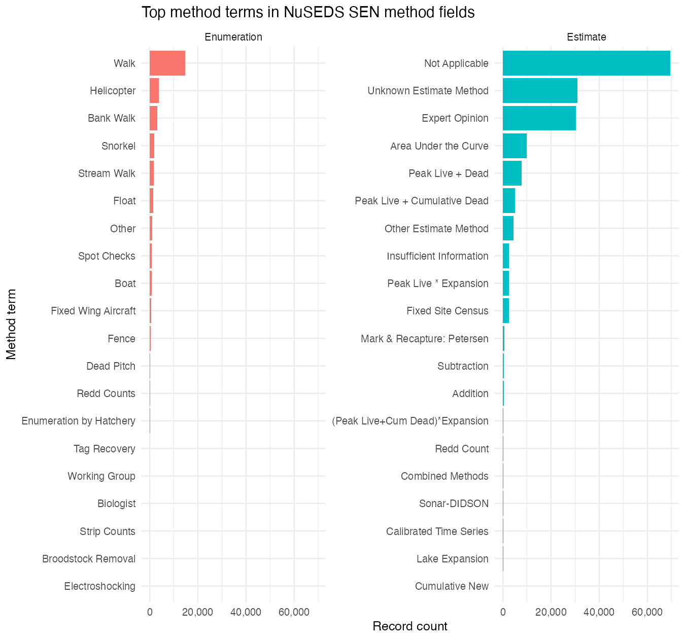

# Applying the guidance in practice

Next, we summarize the substantive updates to the Type 1--6 guidance and how it should be applied during NuSEDS data entry and review.

## What is new in this guidance

Compared to table-only interpretation, the updated guidance:

- Uses a property-first decision sequence (rather than a table lookup).
- Separates enumeration methods (field) from estimation methods (analysis).
- Applies explicit qualifier codes for conservative downgrades (coverage, timing, visibility, documentation, and method-known gaps).
- Treats combined-method estimates as component-based workflows so weaker components are not concealed.
- Encourages recording quantitative uncertainty where available.


## Legacy method vocabulary context

NuSEDS stores historical method terminology across multiple legacy labels. To support implementation planning, we reviewed method distributions in both `ENUMERATION_METHODS` and `ESTIMATE_METHOD` and retained the most frequent terms for review and mapping, with longer-tail terms preserved through controlled mapping in Appendix C.

```{r method-field-top-terms, fig.width=6.0, fig.height=5.2, fig.cap="Top 10 method terms in NuSEDS SEN method fields (enumeration and estimate), based on the all-area SEN method extract assembled for this report (analysis years 1990--2025)."}

```

These frequencies should be read as a dated implementation snapshot rather than as a stable inventory of all future NuSEDS values. Appendix D summarizes the source and processing notes used for this exploratory method-term review.

## How to apply the guidance moving forward

For most users, the simplest way to apply this guidance is through the **Escapement Estimate Type Toolkit** (R Shiny application). A current ShinyApps.io deployment is available at:

- <https://dfo-pac-sci-dev.shinyapps.io/smn-escapement-toolkit/>

The toolkit guides users through the same decision sequence described in this report and produces (i) a **Final Type** (1--6) and (ii) explicit qualifier/downgrade codes. The report remains the authoritative guidance; the toolkit is the operational companion. For operational entry, users should record the toolkit **Final Type** as the estimate-type classification result, store qualifier codes in `DOWNGRADE_CRITERIA`, and use `ESTIMATE_TYPE_CLASS_JUSTIFICATION` plus `ANALYSIS_EXPLANATION` to capture the rationale and any combined/calibrated method detail. `Max Type`, `Provisional Type`, and `Candidate Type` are toolkit-internal QA trace values and should not be treated as the official uploaded classification.

### Classification Examples

The following examples illustrate how annual estimates may be classified using the Salmon Escapement Classification Toolkit. These examples represent common scenarios but are not exhaustive. Alternative classification pathways may apply depending on the survey design, estimation methods, data quality, and available documentation.

Example 1: Fixed-site census with a minor breach  

This example is based on a hypothetical fixed-site counting facility that experienced a minor breach during the season. The breach and associated monitoring activities were well documented.

1. Is this a presence/not-detected record? 
   Answer is No.
2. Are survey and analytically methods adequately identified? 
   Answer is Yes
3. Select your method group from the following: fixed site census (manual or electronic), visual ground/snorkel, aerial survey count, hydro acoustic sonar (modelled count), Trap model (non-spanning), redd survey, electrofishing CPUE index, mark-recapture modelled count.
   Answer is fixed site census (manual or electronic).
4. Is the site a constrained opening with negligible bypass paths?
  Answer is Yes.
5. Were bypass/breach risks monitored and verified negligible across the run?
  Answer is No.
6. Was run-window coverage and counting uptime >= 95%? Answer is Yes.
7. Is this an automated electronic counter/video/resistivity system?
  Answer is Yes.
8. Quality Assurance of automated events documented (review >=10% or >=500 events)? Answer is Yes.
9. Cross-section fully covered at opening?
  Answer is Yes.
10. Documentation present (SIL/SEN logs and methods/QA report)?
  Answer is Yes.
11. Estimation method = Fixed-Station Tally?
  Answer is Yes.

Final classification is Type-2 is absolute abundance (qualified).  


Example 2: Visual survey program with moderate coverage

This example is based on a hypothetical visual survey program with multiple surveys conducted throughout the spawning season. Survey timing and viewing conditions were good, but spatial coverage was incomplete.

1. Is this a presence/not-detected record?
  Answer is No.
2. Are survey and analytically methods adequately identified? 
   Answer is Yes.
3. Select your method group from the following: fixed site census (manual or electronic), visual ground/snorkel, aerial survey count, hydro acoustic sonar (modelled count), Trap model (non-spanning), redd survey, electrofishing CPUE index, mark-recapture modelled count. Answer is visual ground/snorkel.
4. Greater than 5 visits spanning rise, peak, and tail?
   Answer is Yes.
5. Reach coverage >= 80% across the season?
  Answer is No.
5. Severe visibility issues or reach coverage < 50%?
  Answer is No.
  
Final classification is Type-3 or Relative abundance (high resolution).

Example 3: Presence of a non-target species in a test fishery

This example is based on a hypothetical observation of a non-target salmon species recorded during a test fishery in a river.

1. Is this a presence/not-detected record?
  Answer is Yes

Final classification is Type-6 or Presence/Not detected. 

### Authoritative decision-key logic and change requests

The authoritative decision-key logic is maintained as a version-controlled YAML file in the private toolkit repository on GitHub. Requests to update the logic (new method terms, revised thresholds, clarified combination rules, etc.) should be submitted as a GitHub issue by contributors or emailed to **FADSDataStewardship-GestiondesdonneesSFDA@dfo-mpo.gc.ca** for other users.

### What must be recorded

Uploads should include enough method and evidence context that data users can interpret both the assigned Type and any conservative qualifiers. For teams that still populate legacy accuracy/precision labels alongside estimate Type, Appendix C.3 documents the compact lookup currently used in the toolkit. In practice, this means recording:

- the primary enumeration and estimation methods;
- key qualifiers (coverage, uptime, breach/bypass, timing, visibility, and any infilling/interpolation context);
- documentation evidence sufficient for independent interpretation; and
- quantitative uncertainty where available.

A compact, single-table rule summary is provided in Appendix A.
